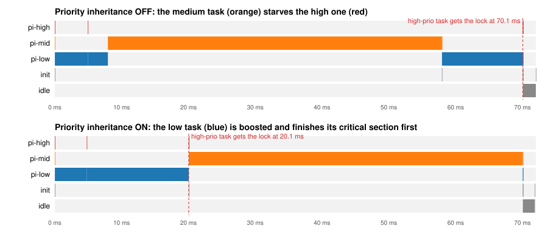

# Kestrel — a from-scratch RTOS and int8 neural-network runtime for ARM Cortex-M4

[](https://github.com/RishitheB0T/kestrel-rtos/actions/workflows/ci.yml)

Kestrel is a small operating system for STM32F4 microcontrollers (ARM Cortex-M4F), written
from scratch in C and Thumb-2 assembly with no vendor HAL, CMSIS, or libc. It runs untrusted
application tasks **unprivileged and isolated by the MPU**, survives their crashes, and runs
an **int8 CNN** produced by a small model compiler (train → quantize → plan memory →
generate C), using hand-optimized DSP-SIMD kernels.

It's a scaled-down version of what an OS and an inference stack do on a GPU-class SoC:
schedule work, isolate it, recover from faults, and run quantized neural networks fast.



*Recorded by the kernel's own tracer in QEMU, rendered by `tools/trace2perfetto.py`. Without
priority inheritance the high-priority task waits **65 ms**. With it, the wait is **15 ms**.*

## Highlights

| | |
|---|---|
| **Scheduler** | Fixed-priority preemptive, 32 levels, O(1) pick via ready-bitmap + `CLZ`, round-robin time slices, tick-based sleep/timeouts |
| **Context switch** | PendSV handler in assembly. Saves r4–r11 always and s16–s31 only if the task used the FPU (checked via `EXC_RETURN`), working with the CPU's lazy FP stacking |
| **Isolation** | Tasks run unprivileged; kernel RAM, other stacks and peripherals are MPU-protected; 7 kinds of illegal access are caught and only the offender is killed |
| **System calls** | `svc` trap, table dispatch, every user pointer validated (confused-deputy safe), capability-style MMIO grants that can be delegated but never widened |
| **Synchronization** | Semaphores, message queues (zero-copy hand-off to waiting receivers), mutexes with **transitive priority inheritance**, **deadlock detection**, and **robust** owner-died recovery |
| **Drivers & observability** | Interrupt-driven UART with ring buffers and blocking writers; cycle-accurate timestamps from SysTick; per-task CPU accounting; stack high-water marks; event tracer → Perfetto |
| **NN runtime** | Per-channel int8 post-training quantization, zero-point folding, fixed-point requantization, fused conv+bias+ReLU, greedy static memory planner, ahead-of-time C codegen |
| **NN kernels** | Naive reference → `SMLAD`/`SXTB16` SIMD → SIMD + 2×2 register tiling: **4.1× fewer instructions**, all **bit-exact** against the Python reference |
| **Testing** | 24 on-target tests (QEMU in CI, or the `test` shell command on hardware), host tests under ASan/UBSan, property-tested memory planner |

## Results (all measured, nothing estimated)

**CNN on 8×8 handwritten digits** (UCI digits, 359 held-out test images):

| | |
|---|---|
| Float32 accuracy | 98.33 % |
| Int8 accuracy | 98.33 % (100 % of predictions identical to float) |
| Weights in flash | 6.6 KB (float32 would be 24.4 KB) |
| Activation RAM | 1,344 B with the memory planner vs 3,056 B without (−56 %) |
| Work per inference | 84,224 multiply-accumulates |

**Kernel speed: instructions executed per inference.** Measured exactly in QEMU with `-icount`.
QEMU does not model pipeline timing, so these are instruction counts, not cycles.
Run `bench` on a board for real cycle counts.

| Kernel | Instructions / inference | Instructions / MAC | vs naive |
|---|---:|---:|---:|
| Naive C (reference) | 1,151,529 | 13.67 | 1.00× |
| DSP SIMD (`SMLAD`, `SXTB16`) | 479,357 | 5.69 | 2.40× |
| SIMD + 2×2 register tiling | 280,089 | 3.32 | **4.11×** |

**Kernel:** a semaphore ping-pong round trip (2 context switches + 4 system calls) takes **684
instructions**. The table below is for real-board numbers from `bench` and `test` on an STM32F4:

| Board | Naive cycles | Tiled cycles | Speedup | Round trip cycles |
|---|---:|---:|---:|---:|
| *your board here* | | | | |

## Try it in 2 minutes (no hardware needed)

```bash
sudo apt install gcc-arm-none-eabi libnewlib-arm-none-eabi qemu-system-arm make python3
make run          # boots Kestrel in QEMU with an interactive shell (quit: Ctrl-A, then X)
make test         # runs the 24-test suite in QEMU; exits non-zero on failure
make host-test    # NN kernels natively under ASan/UBSan + memory-planner property test
```

On an STM32F4 board (Nucleo-F401RE/F411RE/F446RE, STM32F4-Discovery, Black Pill):
`make BOARD=nucleo_f4 flash`, then open the serial port at 115200 baud. See
[docs/HARDWARE.md](docs/HARDWARE.md).

```text
kestrel> crash kernel
[kernel] task 'crash' (id 3) killed: MPU: data access violation, pc=0x08003668 addr=0x20001540 cfsr=0x00000082
shell: still alive. crash task exit code -104, cfsr=0x00000082
kestrel> pi
priority inheritance OFF: high-prio task waited 65719 us, low task ran at prio up to 3  (critical section 20 ms, mid task 50 ms)
priority inheritance ON : high-prio task waited 15183 us, low task ran at prio up to 6  (critical section 20 ms, mid task 50 ms)
kestrel> ps
 ID NAME         STATE    PRIO   STACK used/size   CPU%  SWITCHES  EXIT
  0 idle         ready        0       80/512     95.9        12  -
  1 init         RUN         10     1328/4096     0.0        12  -
  2 heartbeat    blocked      2       96/512      0.0         8  -
  3 crash        dead         9      248/1024     0.0         1  -104 (fault)
  4 pi-low       dead         3      160/1024     0.5         5  0
  ...
kestrel> nn 1
  |    ==++##++    |
  |  **++----@@..  |
  |  ..    --##    |
  |        ++**    |   predicted 3 (label 3)
  |        ..@@    |   280 us at 168 MHz (QEMU virtual time)
  |          ==**  |
  |    ::  ..**++  |
  |    **@@##**::  |
```

## Architecture

```text
  unprivileged (Thread mode, PSP)                      privileged (Handler mode, MSP)
 +------------------------------------------+        +-----------------------------------+
 | init (PID 1) -> shell / test runner      |  svc   | syscall.c   dispatch + pointer    |
 | heartbeat (LED via MMIO grant)           | -----> |             validation            |
 | pi-low / pi-mid / pi-high, crash tasks   |        | sched.c     ready bitmap, sleep   |
 | NN app: model_run() -> nn_kernels.c      |        |             list, tick, accounting|
 | lib/user.c: syscall stubs, k_printf      |        | sync.c      sem / mutex+PI / queue|
 +------------------------------------------+        | mpu.c       4 regions per switch  |
        ^  MemManage / BusFault / UsageFault          | fault.c     kill task or panic    |
        +---------------------------------------------| console.c   UART ISR + ring bufs  |
                                                      | trace.c     event buffer          |
   SysTick (1 kHz) ----> tick: wake sleepers,         | context.S   PendSV / SVC / faults |
                         rotate time slices           +-----------------------------------+
   PendSV (lowest prio) -> context switch
```

**Memory map** (64 KB of SRAM, so it fits every STM32F4):

```text
0x2000C000  URAM    16 KB  app .data/.bss        MPU region 1: RW for all tasks, no execute
0x20004000  STACKS  32 KB  task stacks           MPU region 2: only the running task's stack
0x20000000  KRAM    16 KB  kernel data + MSP     no region: privileged only
0x08000000  FLASH  256 KB  code + const data     MPU region 0: read-only, executable
                           (+ region 3: optional per-task MMIO grant, e.g. one GPIO port)
```

The linker script places every object file from `kernel/` into KRAM **by file name**, so a kernel
variable can never accidentally land in task-writable memory. Stacks sit directly above KRAM,
so a stack overflow runs into memory no task may touch and faults right away.

## Design notes

- **Why PendSV for switching:** it is the lowest-priority exception, so a switch requested by
  SysTick, a syscall or an ISR runs only after every interrupt has finished, and switches never nest.
- **Blocking syscalls:** a syscall that has to wait returns `K_PENDING`. Whoever later wakes the
  task writes the result straight into the task's saved `r0` on its stack. No per-call state
  machine is needed.
- **Big kernel lock:** each syscall and ISR body runs with interrupts masked. Every operation is
  short and bounded, which keeps the kernel simple to reason about. The trade-off is worst-case
  interrupt latency, and it can be revisited with `BASEPRI`.
- **Priority inheritance:** a task's effective priority = max(base, top waiter of every PI mutex
  it holds). It is recomputed along the owner → blocked-on → owner chain, so it also handles
  waiters that time out or die.
- **Handles, not pointers:** kernel objects live in kernel RAM. Tasks get typed integer handles
  (`type << 8 | index`), so a semaphore handle passed to `k_mutex_unlock` is rejected.
- **NN zero-point folding:** `Σ(x − zₓ)·w = Σx·w − zₓ·Σw`, and `zₓ·Σw` is a constant per channel,
  so it moves into the bias offline. Padding uses `zₓ` (real zero), which makes the fold exact for
  "same" convolutions too.
- **SIMD lane trick:** `SXTB16` unpacks bytes (0,2) and (1,3) of a weight word. Instead of
  reshuffling weights for every channel, im2col stores inputs once per pixel in order x0 x2 x1 x3,
  so the lanes line up for free.

## Two bugs worth telling

1. **Lazy FPU stacking vs. killing a task.** When a task that used the FPU enters an exception,
   the CPU reserves space for s0–s15 on the task's stack but saves them *later*, only if the
   handler touches the FPU. When the kernel killed such a task and switched away, that deferred
   save fired during the next switch, aimed at the dead task's freed stack, which the MPU
   (correctly) no longer allowed. Innocent tasks, including `init`, were killed with
   `MPU blocked lazy FPU state save` and the system hung. The fix is one line: cancel the pending
   save (`FPCCR.LSPACT = 0`) when discarding a context. Removing it makes
   `context_switch_integrity` fail.
2. **`-ffreestanding` silently de-optimized the SIMD kernel.** The "fast" kernel ran *2× more*
   instructions than the naive one. Cause: `-ffreestanding` implies `-fno-builtin`, so the
   `memcpy` used for unaligned 32-bit loads became a real byte-by-byte function call in the
   innermost loop. With `__builtin_memcpy` it compiles to one `LDR`. Then the disassembly
   showed the tiled loop spilling 10 registers per iteration. Interleaving the two pixels'
   im2col rows and reordering statements took it from 3.67× to 4.1×.

## Tests

`make test` boots an autotest build in QEMU (instruction-counting mode, so timings repeat)
and runs:

```text
syscall_basics            preemption               round_robin            sleep_accuracy
semaphore_ping_pong       queue_fifo               queue_timeout          priority_inheritance
pi_chain_transitive       deadlock_detection       robust_mutex           context_switch_integrity
mpu_kernel_memory         mpu_stack_overflow       mpu_null_pointer       mpu_peripheral_isolation
ppb_privileged_only       div_by_zero_trap         mpu_other_task_stack   syscall_pointer_checks
stack_pool_reuse          cpu_accounting           trace_capture          nn_inference_bitexact
```

`context_switch_integrity` fills all of r4–r11 and s0–s31 with known values in three tasks
that preempt each other, then checks every register. CI uploads the recorded scheduler traces
as JSON. Open them at [ui.perfetto.dev](https://ui.perfetto.dev).

## Repository tour

```text
kernel/      the OS: boot, context switch (context.S), scheduler, sync, syscalls, MPU, faults, UART, trace
include/     public task API (kestrel.h) and syscall numbers
lib/         syscall stubs, printf, string functions (no libc)
nn/          int8 kernels (nn_kernels.c) + generated model and test set
app/         init task, shell, demos, on-target tests, register torture test (asm)
tools/nn/    model compiler: numpy training, quantization, integer reference, memory planner, codegen
tools/       QEMU test runner, trace -> Perfetto/SVG converter
tests/host/  native NN tests (ASan/UBSan), memory planner property test
docs/        learning guide, hardware guide
```

## Limitations and next steps

- Clock stays on the 16 MHz internal oscillator. PLL setup to 84–180 MHz (with flash wait states) is a natural next step.
- No dynamic task kill API, no object deletion (objects are created once and reused), no SMP.
- The tiled conv loop still spills about 6 registers. An assembly micro-kernel or interleaved weight layout would remove them.
- UART TX could use DMA instead of an interrupt per byte. A tickless idle mode would save power.
- The 8×8 digits model is deliberately small; the toolchain shape (quantize → plan → codegen) carries over to MNIST-size models.

See [docs/LEARNING_GUIDE.md](docs/LEARNING_GUIDE.md) for a from-zero walkthrough of every part.
